# The Dispatch — Newsletter Intelligence Engine

A weekly newsletter about the Indian startup and tech ecosystem, run almost hands-free. News is collected Monday to Wednesday. On Wednesday afternoon Gemini Flash picks 8–10 stories and drafts the commentary. Shreya reviews and approves the draft in Telegram, and on Thursday morning it is emailed through Resend, but only if she approved it.

> **Assignment prototype.** Sample data is labelled in the UI (`is_sample`), the editorial voice is an assumption ([docs/ASSUMPTIONS.md](docs/ASSUMPTIONS.md)), and email runs in **test mode**: only the owner's inbox and Resend's test addresses can receive it.

- **Live dashboard:** https://the-dispatch-murex.vercel.app (read-only without the admin password)
- **Repository:** https://github.com/helenamaria-byte/the-dispatch-newsletter-engine
- **Health:** https://the-dispatch-murex.vercel.app/api/health (env var *names* + DB check, never values)

## Architecture

| Piece | Role |
|---|---|
| **Vercel** (Next.js 16, region `sin1`) | Dashboard, API routes, cron targets |
| **Vercel Cron** | Mon–Wed ingest · Wed draft · Wed reminder · Thu send (UTC expressions mapped to IST; each job re-checks IST time + state) |
| **RSS + Google News RSS + GNews API** | 15 Indian startup/tech feeds, 4 Google News searches, 6 GNews queries |
| **Neon Postgres** (Singapore) | Articles, URL-hash + `pg_trgm` title dedup, past-4-issues check, drafts, approvals, subscribers, deliveries, run logs |
| **Gemini Flash** (`gemini-3.8-flash`, `@google/genai`) | Topic tagging, editorial selection, 2–3 sentence commentary, all JSON-schema output, validated in code |
| **Telegram bot** | Draft review: ✏️ Edit · 🔄 Swap · ❌ Reject · ✅ Approve (with confirmation) · reminder · late "Send now" |
| **Resend** | Gated batch send with idempotency keys, List-Unsubscribe one-click headers, signed webhooks for bounces/complaints |



<details><summary>Weekly workflow flowchart (decision points)</summary>


Mermaid sources: [docs/components-map.mmd](docs/components-map.mmd), [docs/workflow-flowchart.mmd](docs/workflow-flowchart.mmd).
</details>

### The weekly cycle (all times IST)

| Job | Route | Target | Vercel cron (UTC) |
|---|---|---|---|
| Ingest news | `/api/cron/ingest` | Mon–Wed ~07:00 | `30 1 * * 1-3` |
| Select + draft + send to Telegram | `/api/cron/draft` | Wed ~15:00 | `30 9 * * 3` |
| Reminder if still pending | `/api/cron/reminder` | Wed after 22:00 | `0 17 * * 3` |
| Send newsletter if approved | `/api/cron/send` | Thu ~08:00 | `30 2 * * 4` |

### Safety guarantees
1. **No email is ever sent unless the issue is `approved`** at the moment of an atomic `UPDATE … WHERE status='approved' AND sent_at IS NULL` claim, in the one function every send path uses.
2. **At most once:** the atomic claim, `deliveries` UNIQUE(issue, subscriber), and Resend idempotency keys.
3. **Suppressed addresses never get mail:** recipients are filtered to `active` at send time, and bounces/complaints arrive via signed webhooks.
4. **Test mode only reaches test recipients.** Live needs `EMAIL_MODE=live` **and** `LIVE_SEND_CONFIRMED=true`, and simulated time can never send live.
5. **Any edit after approval revokes it.**
6. **Only Shreya's chat, with the webhook secret, can approve.**
7. **Cron needs `CRON_SECRET`; dashboard writes need the admin password.**
8. **Secrets** stay out of the repo, logs and UI; gitleaks runs before each push.

Details: [docs/SCHEMA.md](docs/SCHEMA.md).

## Setup (≤10 steps)

1. `git clone https://github.com/helenamaria-byte/the-dispatch-newsletter-engine && cd the-dispatch-newsletter-engine && npm i` (Node 20+).
2. `cp .env.example .env.local` and fill in the keys (each line explains where to get it). Generate `CRON_SECRET`, `TELEGRAM_WEBHOOK_SECRET`, `UNSUBSCRIBE_SIGNING_SECRET` and `ADMIN_PASSWORD` with `node -e "console.log(require('crypto').randomBytes(32).toString('base64url'))"`.
3. Message your bot `/start`, then read your chat ID: `curl https://api.telegram.org/bot<TOKEN>/getUpdates` → `TELEGRAM_CHAT_ID`.
4. `npm run db:migrate && npm run db:seed`.
5. `npm run dev` → http://localhost:3000. Try a job locally: `npx tsx scripts/run-job.ts ingest`, then `npx tsx scripts/run-job.ts draft --force`.
6. Tests: create a Neon branch, put its URL in `TEST_DATABASE_URL`, then run `npm test`.
7. Deploy: `vercel link`, add every variable with `vercel env add NAME production`, then `vercel --prod`.
8. Set `APP_BASE_URL` to the production URL and redeploy.
9. Register the webhooks: Telegram `setWebhook` with `url=<APP_BASE_URL>/api/telegram/webhook` and `secret_token=<TELEGRAM_WEBHOOK_SECRET>`. For Resend, `POST /webhooks` to `<APP_BASE_URL>/api/resend/webhook` with events `email.sent`, `email.delivered`, `email.bounced`, `email.complained`, and save the returned `signing_secret` as `RESEND_WEBHOOK_SECRET`.
10. Check it: `npm run e2e` (production checks) and `npm run screenshots`.

## Demo the whole week in five minutes (simulated time)

Open the dashboard → **Run manually ▾** → enter the admin password. Each button runs a real job. A **Simulate time (IST)** value makes the job behave as if it were that moment. It is recorded in the run log and can never trigger a live send.

1. **Collect:** leave the time empty and click *Run ingestion now* (tick *include a deliberately broken test feed* to see graceful failure). Open **News Articles** to see candidates, duplicates and source health.
2. **Select:** simulate *Wednesday 15:00* of this week and click *Run selection + send draft to Telegram* (tick *regenerate* if a draft already exists). The draft appears in Telegram and under **Newsletter Draft**.
3. **Review:** in Telegram, tap ✏️ / 🔄 / ❌ on a story, then ✅ *Approve draft* → *Yes*. Any later edit drops the issue back to pending.
4. **Reminder:** without approving, simulate *Wednesday 21:59* → *Run reminder check* (skips), then *Wednesday 22:01* (sends one reminder; a second run skips).
5. **Send:** simulate *Thursday 08:00* → *Run send check*. Approved: emails go to the test recipients (test mode). Not approved: nothing is sent, the issue becomes *skipped*, and Telegram explains why.
6. Watch **Approval Status**, **Subscribers** (bounced/complained update via webhooks) and **Workflow Logs**.

## Repository map

```
app/                 dashboard (page.tsx), unsubscribe page, API routes (cron, telegram, resend, admin, unsubscribe, health)
lib/                 ingest · editorial (selection, validation, commentary) · issues (state machine) · email (gate, template)
                     telegram · jobs (cron jobs + run log) · time (IST schedule) · topics · normalize · sources · auth
db/migrations/       SQL migrations
scripts/             migrate, seed, run-job, e2e, screenshots, render-diagrams, live-email-test
tests/               Vitest suites (dedup, selection, workflow, security) against a Neon test branch
docs/                schema, assumptions, diagrams, sample-run (real Gemini output), screenshots, evidence
```

## Known limitations
- **Resend sandbox sender:** without a verified domain, mail comes from `onboarding@resend.dev` and only reaches the account owner and Resend's test addresses. Verify a domain before going live.
- **Hobby cron precision:** each cron fires once a day, somewhere within its hour. The draft can arrive any time between 15:00 and 15:59 IST, and the reminder between 22:30 and 23:29.
- **Free tiers:** Gemini and GNews free-tier rate limits apply. Calls are batched (about 4 Gemini calls per week plus one per tagging batch) and retried with backoff.
- **Google News links** stay as Google redirect URLs when they can't be decoded offline.
- Some publishers block cloud IPs (e.g. MediaNama returns 403 from Vercel). Those feeds show as failed in Source health and never fail the run.
- The trigram threshold catches near-identical headlines. Same-event stories worded very differently are left to Gemini's judgement.

## Switching to live sending (later)
1. Verify a sending domain in Resend and change `SENDER` in `lib/email.ts` to an address on it.
2. Import the real subscriber list (CSV → `subscribers`, `is_sample=false`).
3. Set `EMAIL_MODE=live` **and** `LIVE_SEND_CONFIRMED=true` in Vercel, then redeploy. Both are required; simulated-time runs still never send live.
